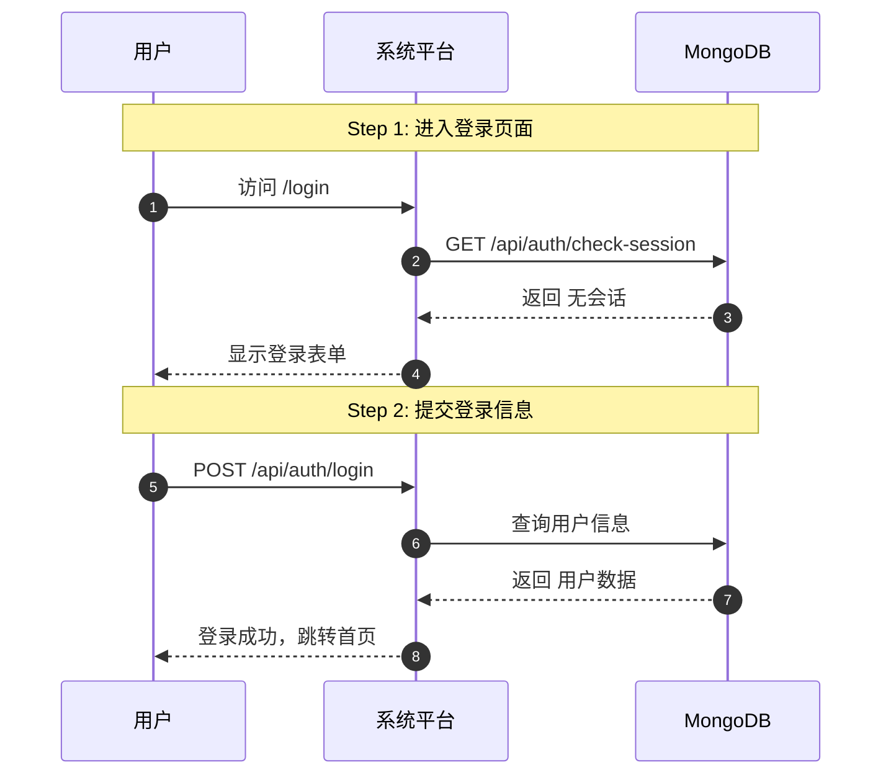
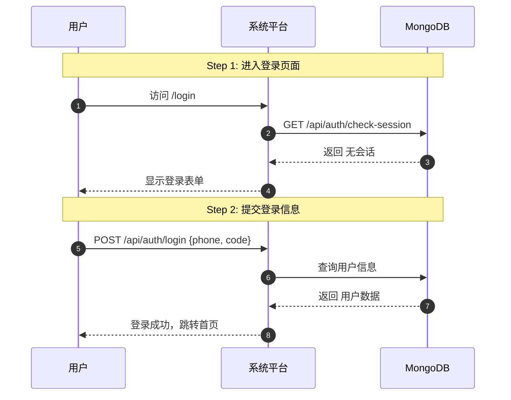

# az-coding 时序图集成方案

## 📋 方案概述

**核心目标**：将 `user-story-mermaid` skill 深度集成到 az-coding 工作流的 Plan 和 Clarify 阶段，确保：
1. **用户可确认**：时序图可视化展示需求理解是否准确
2. **架构专家可开发**：时序图包含完整API路径和交互细节

---

## 🔧 调整方案总览

| 文件 | 调整类型 | 调整内容 |
|------|---------|---------|
| `fullstack-requirement-expert.md` | Agent配置 | 已完成skills装载 |
| `az-coding.md` | Command流程 | Plan/Clarify阶段增加时序图环节 |
| `workflow-manager SKILL.md` | Skill主文档 | Plan阶段增加时序图标准 |
| `9-stages-workflow.md` | 详细定义 | Plan/Clarify详细流程更新 |
| `user-journeys-template.md` | 模板更新 | 增加时序图嵌入格式 |

---

## 🎯 核心设计原则

### 1. 时序图生成时机

```
Plan阶段：
需求分析 → 功能模块拆分 → 每个模块生成时序图 → 嵌入user-journeys.md → 用户确认

Clarify阶段：
用户确认时序图 → 澄清细节 → 更新时序图 → 再次确认
```

### 2. 时序图质量标准

| 检查项 | 标准 | 目的 |
|--------|------|------|
| **模块覆盖** | 每个核心功能模块一个时序图 | 确保完整覆盖 |
| **API路径** | 明确标注 `GET/POST/PUT/DELETE /api/path` | 架构专家可直接定义spec-api.md |
| **参与者** | User、Platform、DB、MinIO、AI等 | 清晰系统边界 |
| **步骤数** | ≤7步 | 避免复杂度 |
| **闭环验证** | 用户能看到最终结果 | 确保功能闭环 |

### 3. 输出文档结构

```markdown
# user-journeys.md

## 功能模块拆分

- 模块1：用户登录
- 模块2：数据查询
- 模块3：文件上传

---

## 模块1：用户登录

### 用户旅途文字描述
[按照模板格式...]

### 时序图（可视化确认）



**⭐ API路径清单**（架构专家使用）：
- `GET /api/auth/check-session` - 检查会话状态
- `POST /api/auth/login` - 用户登录

---

## 模块2：数据查询
[类似结构...]

## 模块3：文件上传
[类似结构...]
```

---

## 📝 详细调整方案

### 1. fullstack-requirement-expert.md（已完成）

```yaml
---
skills:
  - workflow-manager
  - user-story-mermaid  # 已装载
---
```

**Agent提示词已增加**：
```markdown
## 🔄 9阶段工作流中的Plan阶段

### Plan阶段核心任务

4. **⭐ 生成时序图**（推荐）:
   - 当用户旅途涉及多系统交互时
   - 调用 `Skill(user-story-mermaid)` 生成标准化Mermaid时序图
   - 将时序图嵌入 `user-journeys.md`
```

### 2. az-coding.md 调整方案

**阶段1：Plan（需求规划）调整**

```markdown
### 阶段1：Plan（需求规划）

- **执行者**：fullstack-requirement-expert（需求专家）
- workflow-manager skill调用**需求专家**进行深度需求分析

**新增流程**：

1. 需求专家分析需求，拆解功能模块（如：登录、查询、上传等）
2. 需求专家**为每个功能模块调用 `Skill(user-story-mermaid)`**
3. 生成时序图并嵌入 `user-journeys.md`
4. 输出文档：
   - `plan.md`：需求概述、业务目标、模块拆分
   - `user-journeys.md`：用户旅途文字 + **每个模块的时序图**

**⭐ 新增验证环节**：

输出时序图后，展示给用户确认：

```
📊 时序图已生成，请确认需求理解是否准确：

模块1：用户登录
[展示Mermaid渲染结果]

模块2：数据查询
[展示Mermaid渲染结果]

...

⚠️ 请确认：
[1] 时序图准确，继续
[2] 需要调整，请说明
```

用户确认后，进入Clarify阶段。
```

**阶段2：Clarify（需求澄清）调整**

```markdown
### 阶段2：Clarify（需求澄清）

- **执行者**：fullstack-requirement-expert（需求专家）

**新增流程**：

1. 基于用户对时序图的反馈进行澄清
2. 如用户要求调整时序图：
   - 更新需求理解
   - **重新调用 `Skill(user-story-mermaid)` 更新时序图**
   - 再次展示确认
3. 确认开发原则（权限、数据库、验证）
4. 更新 `plan.md` 和 `user-journeys.md`

**⭐ 最终确认**：

Clarify完成后，再次展示完整时序图清单：

```
📋 最终需求确认

模块数量：X个
时序图数量：X个

时序图清单：
- US-01-登录.mmd ✅ 用户已确认
- US-02-查询.mmd ✅ 用户已确认
- US-03-上传.mmd ✅ 用户已确认

API路径总数：X个（架构专家将基于此定义spec-api.md）

⚠️ 请最终确认：
[1] 确认无误，进入Tasks阶段
[2] 还有疑问，继续澄清
```
```

### 3. workflow-manager SKILL.md 调整

**Plan阶段核心要求更新**：

```markdown
### Plan: 定义需求和用户旅途（闭环率=100%）

- 设计用户旅途（至少3个），定义可视化入口和可操作路径
- **⭐ 拆解功能模块**（新增）：
  - 分析需求，识别独立功能模块
  - 每个模块命名：`模块{N}-{功能名}`
- **⭐ 生成时序图**（新增）：
  - 需求专家调用 `Skill(user-story-mermaid)`
  - 每个功能模块生成一个时序图
  - 时序图嵌入 `user-journeys.md`
- 创建 `plan.md` 和 `user-journeys.md`
- **⭐ 用户确认时序图**（新增）：
  - 展示时序图给用户确认
  - 确认后进入Clarify阶段

**验证**：
- `python3 scripts/validate_user_journeys.py --min-journeys 3 --min-closure-rate 100`
- **新增**：`python3 scripts/validate_sequence_diagrams.py --min-diagrams 3`（验证时序图数量）

**完成标准**：
- ✅ 至少定义3个用户旅途
- ✅ 预期闭环率 = 100%
- ✅ **至少生成3个时序图**（新增）
- ✅ **用户确认时序图准确**（新增）
```

### 4. user-journeys-template.md 更新

```markdown
# User Journeys Template（含时序图）

用户旅程设计文档模板

## 文档信息

- **功能名称**: [功能名称]
- **创建日期**: [YYYY-MM-DD]
- **模块数量**: [核心功能模块数量]
- **时序图数量**: [时序图数量]

---

## 功能模块拆分

| 模块ID | 模块名称 | 核心功能 | 涉及系统 |
|--------|---------|---------|---------|
| 模块1 | 用户登录 | 手机号+验证码登录 | Platform、DB |
| 模块2 | 数据查询 | 列表查询+筛选 | Platform、DB |
| 模块3 | 文件上传 | 分片上传+进度展示 | Platform、DB、MinIO |

---

## 模块1：用户登录

### 用户旅途文字描述

[按照原模板格式...]

### ⭐ 时序图（可视化确认）



### ⭐ API路径清单（架构专家使用）

| API路径 | HTTP方法 | 请求参数 | 响应数据 | 用途 |
|---------|---------|---------|---------|------|
| `/api/auth/check-session` | GET | - | {hasSession: boolean} | 检查会话状态 |
| `/api/auth/login` | POST | {phone, code} | {userId, token} | 用户登录 |

### 用户确认状态

- ✅ 已确认 / ⏳ 待确认

---

## 模块2：数据查询

[类似结构...]

---

## 模块3：文件上传

[类似结构...]

---

## 时序图质量检查清单

- [ ] 每个模块有对应时序图
- [ ] 时序图包含完整API路径
- [ ] 步骤数 ≤ 7步
- [ ] 用户能看到最终结果（闭环）
- [ ] 参与者标注清晰

## 闭合率计算

- **总路径数**: [数字]
- **有返回方式的路径数**: [数字]
- **预期闭合率**: [公式]
- **目标**: 100%
```

---

## 🔄 工作流完整流程（调整后）

```
用户输入需求
    ↓
az-coding启动
    ↓
Plan阶段（需求专家）
    ├─ 分析需求，拆解功能模块
    ├─ 为每个模块调用 Skill(user-story-mermaid)
    ├─ 生成时序图嵌入user-journeys.md
    ├─ 输出plan.md + user-journeys.md
    └─ **展示时序图给用户确认** ⭐ 新增
    ↓
用户确认时序图
    ├─ 确认 → 进入Clarify
    └─ 调整 → 需求专家更新时序图 → 再次确认
    ↓
Clarify阶段（需求专家）
    ├─ 基于时序图反馈澄清
    ├─ 确认开发原则
    ├─ 更新plan.md + user-journeys.md
    └─ **再次展示时序图清单确认** ⭐ 新增
    ↓
用户最终确认
    ↓
Tasks阶段（架构专家）
    ├─ **读取user-journeys.md中的时序图** ⭐ 新增
    ├─ 基于时序图的API路径定义spec-api.md
    ├─ 拆解任务
    └─ 输出tasks.md + spec-api.md
    ↓
Dev阶段 → OpenAPI → Test → Verification → QA → Security Review
```

---

## 📋 验证脚本新增

**新增验证脚本**：`scripts/validate_sequence_diagrams.py`

```python
#!/usr/bin/env python3
"""
验证时序图数量和质量
"""

import sys
import re
from pathlib import Path

def validate_sequence_diagrams(plan_dir, min_diagrams=3):
    """验证时序图数量"""
    user_journeys = Path(plan_dir) / "user-journeys.md"
    
    if not user_journeys.exists():
        print(f"❌ user-journeys.md不存在")
        return False
    
    content = user_journeys.read_text()
    
    # 统计mermaid代码块
    mermaid_blocks = re.findall(r'```mermaid.*?```', content, re.DOTALL)
    diagram_count = len(mermaid_blocks)
    
    if diagram_count < min_diagrams:
        print(f"❌ 时序图数量不足：{diagram_count}/{min_diagrams}")
        return False
    
    # 验证每个时序图包含API路径
    for i, block in enumerate(mermaid_blocks, 1):
        if not re.search(r'(GET|POST|PUT|DELETE|PATCH)\s+/api/', block):
            print(f"❌ 时序图{i}缺少API路径标注")
            return False
    
    print(f"✅ 时序图验证通过：{diagram_count}个")
    return True

if __name__ == "__main__":
    import argparse
    parser = argparse.ArgumentParser()
    parser.add_argument("--plan-dir", required=True)
    parser.add_argument("--min-diagrams", type=int, default=3)
    
    args = parser.parse_args()
    
    if not validate_sequence_diagrams(args.plan_dir, args.min_diagrams):
        sys.exit(1)
```

---

## 🎯 架构专家使用时序图的流程

```markdown
## Tasks阶段：架构专家读取时序图

1. **读取user-journeys.md**
2. **提取每个模块的时序图**
3. **基于时序图API路径定义spec-api.md**

示例转换：

时序图中：
```
User->>Platform: POST /api/auth/login {phone, code}
Platform->>DB: 查询用户信息
DB-->>Platform: 返回 用户数据
Platform-->>User: 登录成功
```

spec-api.md中：
```markdown
### POST /api/auth/login

**请求Schema**:
```typescript
const LoginRequestSchema = z.object({
  phone: z.string().regex(/^1[3-9]\d{9}$/),
  code: z.string().length(6)
});
```

**响应Schema**:
```typescript
const LoginResponseSchema = z.object({
  userId: z.string(),
  token: z.string()
});
```
```
```

---

## ✅ 方案总结

| 调整项 | 实现方式 | 目的 |
|--------|---------|------|
| **Skills装载** | Agent frontmatter添加 | 预加载skill内容 |
| **Plan阶段集成** | 需求专家主动调用Skill | 生成可视化确认文档 |
| **用户确认环节** | az-coding展示时序图 | 确保需求理解准确 |
| **架构专家使用** | 读取时序图API路径 | 直接定义spec-api.md |
| **验证脚本新增** | validate_sequence_diagrams.py | 自动验证时序图质量 |

---

## 🚀 预期效果

1. **用户视角**：看到可视化时序图，快速确认需求是否被正确理解
2. **架构专家视角**：基于时序图的API路径，高效定义spec-api.md
3. **质量保证**：每个模块有完整时序图，确保功能闭环和API完整性