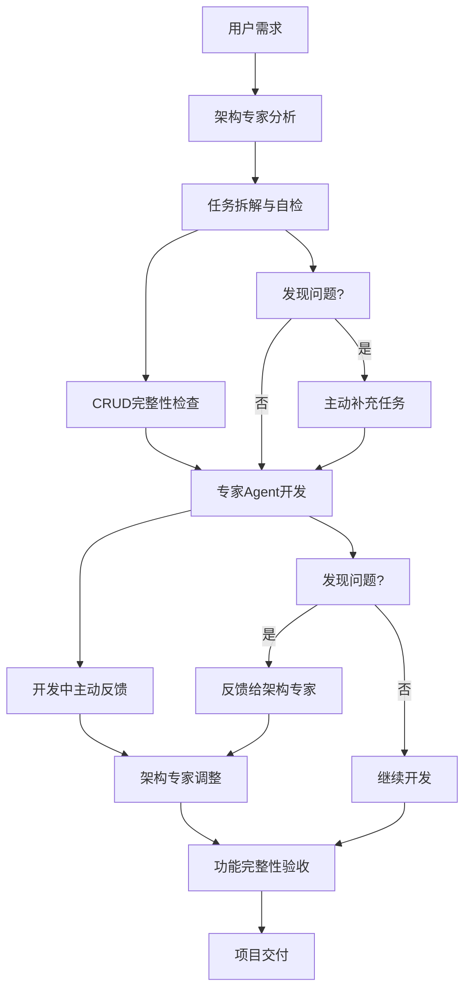

# 🤖 Agent协作详细流程指南

本文档详细说明深瞳AI Coding项目中的Agent协作机制和最佳实践。

## 🔄 协作模式选择

深瞳AI Coding采用**分层协作模式**，根据任务复杂度选择不同的协作方式。

### 模式1：直接协作（推荐用于简单任务）

**适用场景**:
- 日常开发、简单问题、快速决策
- 单一专家可以独立完成的任务
- 任务预估时间 < 4小时

**协作方式**:
- Agent间直接沟通，无需复杂流程
- 快速决策和执行

**优势**:
- 高效、灵活、低开销
- 减少文档管理工作

**示例**:
- 前端需要API接口 → 直接找backend-expert
- UI样式问题 → 直接咨询frontend-expert
- 简单bug修复 → 相关专家直接处理

### 模式2：Workflow协作（用于复杂项目）

**适用场景**:
- 新功能开发、多专家协作
- 需要完整文档管理
- 任务预估时间 > 4小时

**协作方式**:
- 使用workflow-manager的9阶段流程
- 结构化文档管理

**优势**:
- 结构化、可追踪、质量保证
- 完整的需求到交付记录

**入口**: workflow-manager技能 → 启动完整工作流

### 协作方式对比

| 特性 | 直接协作 | Workflow协作 |
|------|---------|-------------|
| **启动成本** | 低 | 高 |
| **适用场景** | 简单任务 (<4小时) | 复杂项目 (>4小时) |
| **文档要求** | 最小化 | 完整文档 |
| **协作规范** | 灵活 | 结构化 |
| **质量保证** | 事后检查 | 全程QA |

### 选择建议

- ✅ **优先使用直接协作**：除非确需复杂管理
- ✅ **Workflow仅用于**: 真正复杂的多专家协作项目
- ✅ **避免过度管理**: 不要为了用流程而用流程

## 🎯 Agent直接协作流程

### 前端 ⇄ 后端

**场景**: 前端需要新的API接口

```
1. frontend-expert识别需要新API
2. 直接联系backend-expert
3. backend-expert创建API路由
4. frontend-expert集成API
5. 完成，无需workflow
```

**示例对话**:
```
frontend-expert: "用户管理页面需要获取用户列表的API"
backend-expert: "好的，我创建 GET /api/users 接口"
```

### 前端 ⇄ 架构

**场景**: 前端需要架构决策

```
1. frontend-expert遇到架构问题
2. 直接咨询architecture-planning-expert
3. 架构专家给出决策
4. frontend-expert执行
```

**示例场景**:
- 页面状态管理方案选择
- 组件复用策略
- 性能优化建议

### 后端 ⇄ QA

**场景**: 后端需要测试验证

```
1. backend-expert完成API开发
2. 直接联系qa-expert
3. qa-expert进行功能验证
4. 反馈问题或确认通过
```

### 架构 ⇄ 任意专家

**场景**: 架构专家指导其他专家

```
1. 任何专家遇到技术难题
2. 咨询architecture-planning-expert
3. 架构专家提供指导方案
4. 执行专家实施
```

## 🏗️ Workflow协作流程

### 9阶段流程概览

```
Plan（需求规划）
  ↓
Clarify（需求澄清）
  ↓
Tasks（任务拆解）
  ↓
Dev（开发执行）
  ↓
Test（测试执行）
  ↓
Verification（覆盖率检查）
  ↓
QA（质量验收）
  ↓
Security Review（安全审查）⭐ 新增
  ↓
Done（项目完成）
```

### Phase 1: Plan（需求规划）

**负责专家**: fullstack-requirement-expert

**主要任务**:
1. 分析用户原始需求
2. 创建plan.md项目计划文档
3. 识别项目范围和约束
4. 确定项目类型（简单/复杂）

**输出文档**:
- `plan.md` - 项目需求计划

**关键原则**:
- ✅ 使用workflow-manager技能启动
- ✅ 记录用户原始需求
- ✅ 识别技术约束
- ❌ 避免过度详细规划

### Phase 2: Clarify（需求澄清）

**负责专家**: fullstack-requirement-expert

**主要任务**:
1. 通过最多5轮交互式提问
2. 完善和细化需求
3. 更新plan.md
4. 确认技术选型

**输出文档**:
- `plan.md` (更新版) - 澄清后的需求

**关键原则**:
- ✅ 最多5轮提问
- ✅ 明确功能边界
- ✅ 识别CRUD需求
- ❌ 避免无限澄清

### Phase 3: Tasks（任务拆解）

**负责专家**: architecture-planning-expert

**主要任务**:
1. 基于需求创建tasks.md
2. 拆解为可执行任务列表
3. 识别任务依赖关系
4. 分配专家agent

**输出文档**:
- `tasks.md` - 详细任务列表
- `communication/spec-api.md` - API契约文档

**关键原则**:
- ✅ 基需求的CRUD检查
- ✅ POC规范合规检查
- ✅ 任务责任明确
- ✅ 开发确认机制

**自检清单**:
- [ ] 基于需求的CRUD检查
- [ ] 功能覆盖度验证
- [ ] 项目规范合规
- [ ] 主动补充机制
- [ ] 任务责任明确
- [ ] 开发确认机制

### Phase 4: Dev（开发执行）

**负责专家**: frontend-expert, backend-expert

**主要任务**:
1. 按照tasks.md执行开发
2. 主动反馈发现的问题
3. 遵守POC开发原则
4. 完成自测后交付

**输出文档**:
- `communication/active-bridge.md` - 实时开发记录
- 源代码文件

**关键原则**:
- ✅ 主动反馈机制
- ✅ 遵守项目规范
- ✅ 功能完整性保证
- ❌ 避免沉默开发

### Phase 5: QA（质量验收）

**负责专家**: qa-expert

**主要任务**:
1. 执行功能验证
2. 构建验证
3. 用户体验测试
4. 生成qa-report.md

**输出文档**:
- `communication/qa-report.md` - 质量报告

**验收标准**:
- [ ] 功能完整性测试
- [ ] CRUD操作验证
- [ ] 用户体验测试
- [ ] 规范符合性检查

### Phase 6: Done（项目完成）

**负责专家**: architecture-planning-expert

**主要任务**:
1. 确认所有任务完成
2. 更新ai-dev-plan.md
3. 项目归档

**输出文档**:
- `ai-dev-plan.md` - 更新项目状态

## 📋 Agent职责清单

### 架构专家（architecture-planning-expert）

**职责**:
- [ ] 需求分析完整性
- [ ] 基于需求的CRUD检查
- [ ] 项目规范合规
- [ ] 任务拆解清晰
- [ ] 依赖关系明确
- [ ] 主动补充缺失
- [ ] 任务责任明确
- [ ] 开发确认机制

**关键能力**:
- 需求理解和技术转换
- 任务拆解和依赖管理
- 跨专家协调
- POC原则执行

### 开发专家（frontend-expert, backend-expert）

**职责**:
- [ ] 主动反馈机制
- [ ] 实现规范遵守
- [ ] 功能完整性保证
- [ ] 质量优先原则
- [ ] 持续沟通协调
- [ ] 测试验证充分

**关键能力**:
- 技术实现能力
- 问题识别和反馈
- 代码质量保证
- 协作沟通能力

### QA专家（qa-expert）

**职责**:
- [ ] 功能完整性测试
- [ ] 构建验证
- [ ] 用户体验验证
- [ ] 质量报告输出
- [ ] 最终验收权

**关键能力**:
- 功能测试能力
- 问题识别能力
- 质量把关能力

## ⚡ 快速协作指南

### 发现问题时

1. **立即停止当前工作**
2. **识别问题类型**（需求缺失、实现问题、规范违反）
3. **主动反馈给相关专家**
4. **等待确认和调整**
5. **继续执行调整后的方案**

### 任务拆解时

1. **使用基于需求的CRUD检查清单**
2. **验证项目规范合规性**
3. **检查功能覆盖完整性**
4. **确保任务责任明确和专家分配**
5. **建立开发确认机制**
6. **与用户和专家确认调整内容**

### 开发实现时

1. **严格遵循设计方案**
2. **发现不一致时立即反馈**
3. **保持与架构专家沟通**
4. **确保实现符合规范**
5. **完成自检后再交付**

## 📊 协作流程图



## 📚 项目规范依据

本协作流程基于 `CLAUDE.md` 的以下规定：

- **POC项目无权限系统** - 专注核心功能验证
- **Token仅用于登录状态** - 不做权限验证
- **所有功能对所有用户开放** - 登录用户可用所有功能
- **简化数据校验** - 仅前端基础校验，后端简化处理

## ✅ 预期协作效果

实施完成后：

1. 任务拆解完整性大幅提升
2. 功能遗漏风险显著降低
3. 项目规范得到严格执行
4. Agent协作更加高效
5. 问题发现和解决更加及时

## 🔗 相关文档

- [Workflow Manager完整权限管理标准](../../.claude/skills/workflow-manager/DIRECTORY_STRUCTURE_STANDARD.md)
- [POC开发原则](./poc-development-guide.md)
- [模块开发模板](./module-development-template.md)
