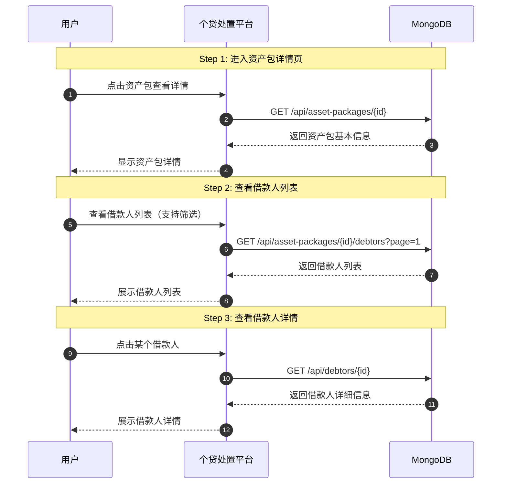
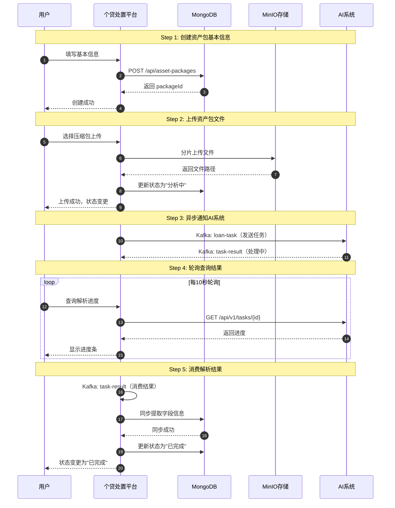
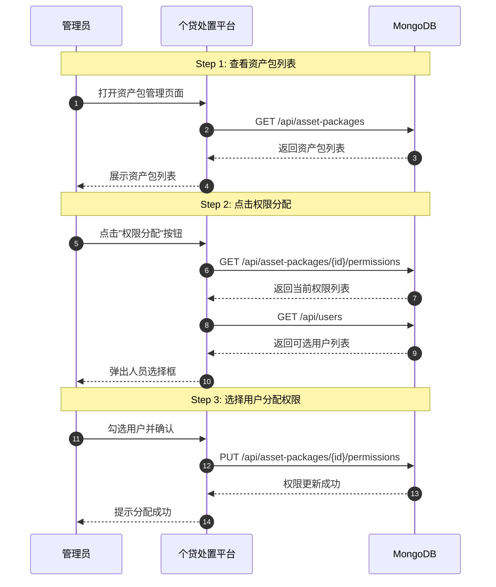

# User Story Mermaid Sequence Diagram Generator

Transform user requirements into clean, standardized Mermaid sequence diagrams that follow best practices from real-world projects.

## Core Philosophy

**Goal**: Produce sequence diagrams that are:

- **Clear** - Easy to understand, not cluttered
- **Complete** - Tell the full user story from start to finish
- **Contracted** - Follow strict constraints to prevent bloat

## Mandatory Constraints

These constraints are **enforced** to keep diagrams clean:

| Constraint         | Limit | Reason                     |
| ------------------ | ----- | -------------------------- |
| Steps count        | ≤ 7   | Prevents vertical bloat    |
| Participants count | ≤ 5   | Prevents horizontal sprawl |
| Messages per step  | ≤ 10  | Prevents step clutter      |

If your analysis exceeds these limits, **merge or simplify** before generating.

---

## Generation Workflow

### Phase 1: Analyze Requirements

Extract from user input:

1. **User Role** → Who initiates the action?
   - `User` - End user
   - `Admin` - Administrator
   - `Manager` - Team manager

2. **System Actors** → What systems are involved?
   - `Platform` / `Frontend` - Main system user interacts with
   - `DB` / `MongoDB` / `Redis` - Data storage
   - `MinIO` / `OSS` / `S3` - File storage
   - `AI` / `ExternalService` - Third-party systems
   - `Kafka` / `MQ` - Message queue (for async flows)

3. **Flow Type** → How does data move?
   - **Sync** - Request → Immediate response
   - **Async** - Request → Background processing → Callback/Polling

### Phase 2: Structure Steps

Each step must have a **clear purpose**. Use this template:

```mermaid
Note over User,DB: Step N: <Purpose Description>
```

**Step Types**:

| Type       | Purpose              | Example                |
| ---------- | -------------------- | ---------------------- |
| Entry      | User enters/starts   | "进入页面", "开始操作" |
| Action     | User performs action | "提交表单", "点击按钮" |
| Processing | System processes     | "保存数据", "调用API"  |
| Async      | Background work      | "轮询结果", "等待回调" |
| Display    | Show result          | "展示列表", "返回详情" |

**Merging Strategy** (when steps exceed 7):

- Combine related actions into one step
- Merge "Processing + Display" into single step
- Skip redundant intermediate states

### Phase 3: Generate Messages

**Request Format**:

```
Actor1->>Actor2: HTTP_METHOD /api/path<br/>Action description
```

**Response Format**:

```
Actor2-->>Actor1: 返回 <Key Data>
```

**Rules**:

- Use standard HTTP methods: `GET`, `POST`, `PUT`, `PATCH`, `DELETE`
- Return only **key identifiers**: id, status, critical data
- Never return full data structures in response

**Async Messages**:

```
Actor1->>Actor2: Kafka: topic-name（消息类型）
Actor2-->>Actor1: Kafka: result-topic（结果类型）
```

**Polling Loop**:

```mermaid
loop 每 N 秒轮询
    User->>Platform: 查询进度
    Platform->>Service: GET /api/tasks/{id}
    Service-->>Platform: 返回进度
    Platform-->>User: 显示进度条
end
```

### Phase 4: Verify Closure

Every user story must **close the loop**:

```
User Action → System Processing → Data Storage → Result → User Perception
```

Check: Does the user **see/know** the final result? If not, add a display step.

---

## Output Template

```mermaid
sequenceDiagram
    autonumber
    participant User as 用户角色
    participant Platform as 系统平台
    participant DB as 数据库
    [other participants as needed]

    Note over User,DB: Step 1: <阶段目的>

    User->>Platform: <用户动作描述>
    Platform->>DB: <API调用>
    DB-->>Platform: <返回关键数据>
    Platform-->>User: <用户感知结果>

    Note over User,DB: Step 2: <阶段目的>
    ...
```

---

## Examples 索引

本skill包含**7个最佳实践级别的真实案例**，来源于真实业务项目（个贷处置平台）。

按类型分类，可按需参考：

### 📁 分类索引表

| Example   | 文件路径                                               | 类型       | 适用场景                                | 关键特征                       |
| --------- | ------------------------------------------------------ | ---------- | --------------------------------------- | ------------------------------ |
| **US-01** | `examples/async-polling/US-01-ai-analysis.mmd`         | 异步+轮询  | AI分析、长时任务、跨系统协作            | 6 Steps, loop, Kafka, 分片上传 |
| **US-02** | `examples/simple-sync/US-02-view-debtors.mmd`          | 简单同步   | 列表查看、详情查看、筛选搜索            | 3 Steps, 纯CRUD                |
| **US-03** | `examples/file-operation/US-03-view-files.mmd`         | 文件操作   | 文件预览、分类筛选、本地搜索            | 4 Steps, MinIO, 字段关联       |
| **US-04** | `examples/file-operation/US-04-field-trace.mmd`        | 文件操作   | 字段溯源、状态修改、逆向定位            | 3 Steps, 双向关联              |
| **US-05** | `examples/admin-operation/US-05-config-rules.mmd`      | 管理员操作 | 数据规则配置、JSON编辑                  | 4 Steps, CRUD                  |
| **US-06** | `examples/admin-operation/US-06-manage-users.mmd`      | 管理员操作 | 用户生命周期管理（新增/编辑/状态/删除） | 5 Steps, 完整闭环              |
| **US-07** | `examples/admin-operation/US-07-permission-assign.mmd` | 管理员操作 | 权限分配、多对多关系                    | 4 Steps, 权限验证              |

### 🎯 快速选择指南

| 你的需求类型                  | 推荐参考             |
| ----------------------------- | -------------------- |
| 长时间异步处理、需要进度展示  | **US-01**            |
| 简单列表查看、详情查看        | **US-02**            |
| 文件上传/预览、文件与数据关联 | **US-03**, **US-04** |
| 管理员配置管理                | **US-05**            |
| 用户账号管理、完整生命周期    | **US-06**            |
| 权限分配、资源授权            | **US-07**            |

### 💡 Example文件结构

每个example文件包含：

1. **元数据注释块** - 类型、适用场景、关键特征、学习要点、约束验证
2. **完整时序图代码** - 可直接复制使用

---

## Quick Examples（内嵌参考）

以下是简化的快速参考示例，完整案例请查看 `examples/` 目录。

### Example 1: Simple CRUD (Sync Flow)

**Requirement**: 用户查看借款人列表

**Generated Diagram**:



---

### Example 2: Async Flow with Polling

**Requirement**: 用户上传资产包，系统异步分析并返回结果

**Generated Diagram**:



---

### Example 3: Admin Permission Management

**Requirement**: 管理员分配资产包权限给其他用户

**Generated Diagram**:



---

## Quality Checklist

Before outputting, verify:

| Check               | Pass Criteria                  |
| ------------------- | ------------------------------ |
| Step Count          | ≤ 7 steps                      |
| Participant Count   | ≤ 5 actors                     |
| Each Step has Note  | All steps labeled with purpose |
| API Format          | HTTP method + path format      |
| Response Simplicity | Only key data returned         |
| Async Handling      | Loop/Note for async flows      |
| Closure             | User perceives final result    |

If any check fails, **revise before output**.

---

## Handling Complex Requirements

When user requirements are complex:

1. **Split into multiple diagrams** - Each diagram tells ONE user story
2. **Use references** - "详见 XX 用户故事时序图"
3. **Focus on main flow** - Skip edge cases in main diagram

**Example**: A feature with both sync and async parts:

- Diagram 1: Sync creation flow
- Diagram 2: Async processing flow (referenced from Diagram 1)

---

## Quick Reference

**Participant Naming**:

- User roles: `User`, `Admin`, `Manager`
- Systems: `Platform`, `Frontend`, `Backend`
- Storage: `DB`, `MinIO`, `Redis`
- External: `AI`, `ExternalService`, `PaymentGateway`
- Messaging: `Kafka`, `MQ`

**HTTP Methods**:

- `GET` - Retrieve data
- `POST` - Create new
- `PUT` - Update existing
- `PATCH` - Partial update
- `DELETE` - Remove

**Response Data** (keep minimal):

- Identifiers: `返回 userId`, `返回 orderId`
- Status: `返回 成功`, `返回 状态变更`
- Key info: `返回 进度 50%`
