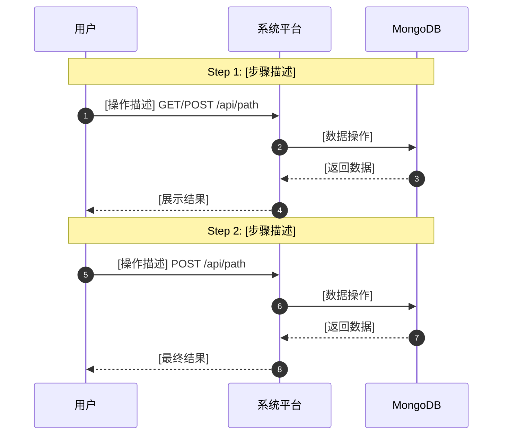

# User Journeys Template

用户旅程设计文档模板（含时序图）

## 文档信息

- **功能名称**: [功能名称]
- **创建日期**: [YYYY-MM-DD]
- **模块数量**: [核心功能模块数量]
- **时序图数量**: [时序图数量]
- **版本**: v1.0
- **作者**: [需求专家]

---

## 功能模块拆分

| 模块ID | 模块名称 | 核心功能 | 涉及系统 |
|--------|---------|---------|---------|
| 模块1 | [名称] | [核心功能描述] | [Platform、DB、MinIO等] |
| 模块2 | [名称] | [核心功能描述] | [涉及系统] |
| 模块3 | [名称] | [核心功能描述] | [涉及系统] |

---

## 模块1：[模块名称]

### 用户旅途文字描述

**目标用户**: [目标用户群体]

**目标**: [用户想要达成什么]

**起点**:
- 入口: [用户从哪里开始]
- 触发条件: [什么情况下触发这个旅程]

**操作路径**:

1. **步骤1**: [操作描述]
   - 可视化入口: [用户能看到什么]
   - 可操作元素: [用户能点击什么]
   - 返回方式: [如何返回上一页]

2. **步骤2**: [操作描述]
   - 可视化入口: [用户能看到什么]
   - 可操作元素: [用户能点击什么]
   - 返回方式: [如何返回上一页]

**终点**: [旅程结束状态]

**返回方式**: [用户如何退出这个旅程]

**预期结果**: [用户期望的结果]

### 时序图（可视化确认）

### API路径清单（架构专家使用）

| API路径 | HTTP方法 | 请求参数 | 响应数据 | 用途 |
|---------|---------|---------|---------|------|
| `/api/xxx` | GET/POST | [参数] | [响应] | [用途描述] |

### 用户确认状态

- ⏳ 待确认

---

## 模块2：[模块名称]

[按照模块1的结构重复...]

---

## 模块N：[模块名称]

[按照模块1的结构重复...]

---

## 可视化入口清单

- [ ] [入口1]: [描述]
- [ ] [入口2]: [描述]
- [ ] [入口N]: [描述]

## 可操作路径清单

- [ ] [路径1]: [起点] → [操作] → [终点]
- [ ] [路径2]: [起点] → [操作] → [终点]
- [ ] [路径N]: [起点] → [操作] → [终点]

## 返回方式清单

- [ ] [页面1]: 返回按钮位置、功能
- [ ] [页面2]: 返回按钮位置、功能
- [ ] [页面N]: 返回按钮位置、功能

## 时序图质量检查清单

- [ ] 每个模块有对应时序图
- [ ] 时序图包含完整API路径（`GET/POST/PUT/DELETE /api/path`）
- [ ] 步骤数 ≤ 7步
- [ ] 用户能看到最终结果（闭环）
- [ ] 参与者标注清晰（User、Platform、DB等）

## 闭合率计算

- **总路径数**: [数字]
- **有返回方式的路径数**: [数字]
- **预期闭合率**: [公式：有返回方式的路径数 / 总路径数 × 100%]
- **目标**: 100%

## 注意事项

- 每个页面都必须有返回方式
- 返回按钮位置统一在左上角
- 异常场景也要有返回方式（如表单验证失败）
- 闭合率必须达到100%
- 每个功能模块必须有对应的Mermaid时序图
- 时序图中的API路径是架构专家定义spec-api.md的唯一来源
